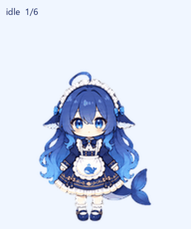
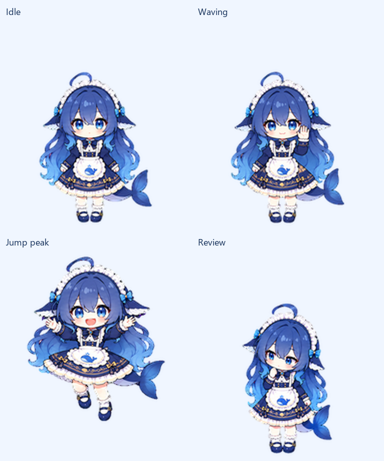

# 蓝色大肥鱼 🐋

这是我的第一个公开项目：把喜欢的角色设计制作成可以陪伴工作的 ChatGPT Pets 动画形象，并保存从标准形象到完整动画的制作过程。

角色拥有蓝色渐变长发、蓝眸、蕾丝女仆头饰、鲸鱼围裙和鲸尾。名字叫 **蓝色大肥鱼**。

## 项目里有什么

| 内容 | 位置 |
| --- | --- |
| 可用于 Pets 的透明动画图集 | [final/spritesheet-extended.png](final/spritesheet-extended.png) |
| 完整动画视频 | [previews/all-states.mp4](previews/all-states.mp4) |
| 十六个视线方向 | [previews/look-loop.gif](previews/look-loop.gif) |
| 待机 → 跳跃 → 待机 | [previews/idle-jump-idle.gif](previews/idle-jump-idle.gif) |
| 标准角色形象 | [references/canonical-base.png](references/canonical-base.png) |
| 生成提示词和修订提示词 | [prompts/](prompts/) |
| 生成源图及保留的失败版本 | [decoded/](decoded/) |
| 帧、方向、边缘和质量检查记录 | [qa/](qa/) |
| 完整制作过程 | [docs/制作过程.md](docs/制作过程.md) |
| 本地查看与导出方法 | [docs/复用说明.md](docs/复用说明.md) |

## 动画规格

最终图集为 **Pets v2**：1536 × 2288 像素，8 列 × 11 行，单帧 192 × 208，透明背景。

| 动作 | 帧数 |
| --- | ---: |
| 待机、眨眼 | 6 |
| 向右跑 | 8 |
| 向左跑 | 8 |
| 挥手 | 4 |
| 跳跃 | 5 |
| 失落 | 8 |
| 等待 | 6 |
| 工作、思考 | 6 |
| 查看结果 | 6 |
| 环绕视线 | 16 |

成品已通过本地质量检查和 Pets 官方格式预检，并成功创建为自定义宠物。

## 如何制作

1. 根据用户提供的 Q 版图、全身图和三视图生成固定的标准形象。
2. 使用 ImageGen 分别生成各组动作，保持发型、服饰、尾巴等身份特征。
3. 提取完整姿势，用每组共享的缩放和基线对齐，保留跳跃高度。
4. 先确定上、右、下、左四个方向，再生成两组视线姿势。
5. 使用 Pets 插件的制作管线组合图集、处理背景边缘并检查动画。
6. 通过独立视觉检查和三人方向盲审，再上传到 Pets。

具体问题与修订方法见[制作过程](docs/制作过程.md)。此仓库保存真实的制作产物和报告；修订失败的版本也保留作为过程参考。

## 许可与参考

项目中新增的 `scripts/` 工具代码采用 [MIT 许可](LICENSE)。角色设计参考由用户从网络提供，原作者及授权链接暂未记录；图片、角色设计和动画素材不包含在该 MIT 代码许可内。素材的再分发及商用授权待原设计权利信息确认，详见 [ARTWORK-NOTICE.md](ARTWORK-NOTICE.md)。

原始参考图片的临时文件在重启后已失效，因此仓库保存的是根据会话参考生成的标准形象和后续制作产物。

创建日期：2026-10-11。项目整理与制作由 Codex 协助完成。
