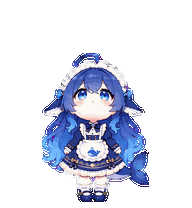

# 蓝色大肥鱼的制作过程

## 1. 从参考图确定角色

用户提供了三张角色图片：大头 Q 版形象、全身形象以及正侧背三视图与表情设定。采用第一张的紧凑比例，结合三视图统一结构，保留蓝色渐变长发、蓝眼睛、呆毛、白色蕾丝头饰、青蓝蝴蝶结、鳍状侧耳、女仆裙、鲸鱼围裙、金色装饰、白袜、深蓝鞋与鲸尾。

用户为形象指定名字：**蓝色大肥鱼**。制作目录中保留的 `jinglan` 只是早期工作目录代号。

微信临时参考文件在重启后已不存在，标准形象直接使用会话中的三张图片生成，之后所有动作以保存的标准形象为固定参考。

标准形象：[canonical-base.png](../references/canonical-base.png)。主要提示词：[base-pet.md](../prompts/base-pet.md)。

## 2. 分别生成九组动作

每组动作独立生成，避免不同状态仅仅重复同一排姿势。向右跑先确定步态；向左跑在角色无文字、固定手持物等语义障碍的前提下，逐帧镜像完整姿势，保持时间顺序。

工作状态的 `running` 表示思考、处理任务，采用站立思考动作。它与拖动时播放的左右跑动不同。

源图保存在 [decoded/](../decoded/)，提示词保存在 [prompts/rows/](../prompts/rows/)。

## 3. 修复源图与提取问题

制作中遇到了几类实际问题：

- 相邻人物的头发或尾巴接触，导致完整姿势无法正确分离。重新生成更小、更分散的姿势；失败图以 `rejected` 文件名保留。
- 按假定等宽槽切割源图会切到邻帧头发。先识别完整的连接部件和姿势，再注册到固定网格。
- 波浪长发和鲸尾增大包围盒，逐帧自动填满会让身高跳动。改为每组使用一个共享比例和基线，保留原始相对运动。
- 挥手与查看结果的早期版本出现手的位置切换。修订整组源图，使参与动作的手保持一致。
- 跳跃需要真实离地。保留蹲下、上升、最高点、下降、落地的垂直差，最终检查测得离地高度为 **32 像素**，落地与待机基线差为 **0 像素**。

这些修改发生在生成源图或确定性提取阶段，没有用手工画图替代角色动作。

## 4. 制作十六个视线方向

先生成并确认上、右、下、左四个方向，再分别生成两个连续的八姿势方向组。躯干、裙子、鞋子保持正面锚定，头部和眼睛主导转向，原本的眼睛设计保持一致。

方向按顺时针排列：

```text
第 10 行：000, 022.5, 045, 067.5, 090, 112.5, 135, 157.5
第 11 行：180, 202.5, 225, 247.5, 270, 292.5, 315, 337.5
```

其中 000 是向上看，090 是屏幕右侧，180 是向下看，270 是屏幕左侧。



## 5. 组合、清边与检查

使用 Pets 0.1.6 插件附带管线提取和组合图集，对最终图集做一次色键边缘处理，再校验最终编码文件。随后输出完整帧表、正常尺寸方向图、各组 GIF、MP4、跳跃过渡和方向循环。

三位独立评审在不知道角度标签和答案的情况下，判断成对姿势的左右、上下方向。四个主要方向全部通过。

检查记录：

- [最终尺寸与透明背景检查](../final/validation-extended.json)
- [最终质量检查](../qa/pet-quality.json)
- [三人盲审汇总结论](../qa/direction-blind-validation.json)
- [十六方向语义记录](../qa/direction-semantics.json)
- [独立最终视觉复核](../qa/final-visual-review.json)
- [Pets 官方预检](../final/pets-preflight.json)

已知的小限制：157.5°、337.5° 在正常尺寸下的水平偏转较弱；独立视觉复核也认为 202.5° 的偏转较细微。相邻右上姿势的可见转幅并非严格均匀。这些已在报告中保留，没有记成毫无差异的完美结果。双腿之间的透明空隙属于正常结构，人工检查未发现躯干或衣服破洞。

## 6. 创建完成

最终文件通过 Pets 官方预检后上传，创建名称为「蓝色大肥鱼」的自定义宠物，再通过宠物列表确认名称和创建结果。公开仓库不保存用户账户中的宠物标识、临时上传会话或临时下载地址。

最终图集 SHA-256：

```text
24ceb96d410f10168baf4fd814b5312efa248aec2c4079dc9685cb3bfce30537
```
